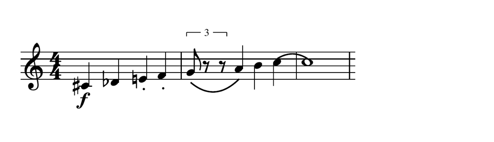

# Driving Gscore with curl

Write a score, engrave it and record it as audio without opening a window — the whole program is an HTTP server and the editor is only one of its clients.

Every command in this chapter was run against a real Gscore before it was
written down, and the files at the end are the files it produced.

## Why this exists

The editor you click on is a web interface talking to a local server. That
server is the program: the model, the importers, the engraver, the renderers
and the synthesiser all live behind it, and the window is one way to reach
them. Start Gscore without the window and `curl` is another.

Which makes a few things easy that are usually hard:

- **Engrave a folder of files overnight.** A loop and six lines of shell.
- **Put music in a build.** A Makefile rule that turns a tune into a PDF and
  an audio file, run by CI like any other asset.
- **Generate music from a program**, in whatever language you already use,
  and get real engraving and a real recording out of it.
- **Check what Gscore makes of a file** without a screen anywhere.

<p class="warn"><b>It is a local server, and it means it.</b> Saving to a
path is refused unless the request is from this machine, and so is recording
audio — rendering an orchestra is work Gscore does not offer to do for
strangers. <code>-serve</code> puts it on a network deliberately; read
<a href="embedding.html">embedding</a> before you do.</p>

## Start it with no window

```sh
gscore -headless -port 8080
```

`-headless` serves the editor and opens nothing. Leave the port off and it
picks a free one and prints it. Everything below assumes:

```sh
G=http://127.0.0.1:8080
```

<p class="note"><b>From a source tree</b>, <code>go run . -headless -port
8080</code> does the same thing.</p>

## More than one score at once

One server holds as many open scores as you like. Each is a **session**, and
a request says which by naming it:

```sh
curl -s "$G/api/info?session=5fae3154fbb4303ec7c06b72973c8de9"
```

**A request that names no session talks to the default one** — the score the
server was started on. That is what every example in this chapter does, and
it is why none of them mention sessions: if you only ever work on one score
at a time, you can forget this section exists.

```sh
# a new, empty score; the answer carries its token
curl -s -X POST "$G/api/session"
```

```json
{"status":"ok","session":"5fae3154fbb4303ec7c06b72973c8de9","reattached":false}
```

From there the token goes on every request for that score, beside whatever
else that request takes:

```sh
S=5fae3154fbb4303ec7c06b72973c8de9
curl -s -X POST "$G/api/abc?session=$S&part=0&measure=0&at=0" \
     --data-binary 'G A B c | d e f g'
curl -s "$G/api/pdf?session=$S" -o second.pdf
```

The two scores are entirely separate — different music, different undo
history, different view settings — and each engraves and records on its own.

### Opening a file finds it if it is already open

```sh
curl -s -G -X POST "$G/api/session" --data-urlencode "path=$PWD/tune.abc"
```

```json
{"status":"ok","session":"c574f0c8…","reattached":false,
 "filename":"/home/you/tune.abc"}
```

Ask for the same file again and you get **the same session back**, with
`reattached` true. Two copies of one file open at once is how work gets
lost — you edit one, save the other, and the program was right both times —
so Gscore will not make the second copy.

### The rest of it

```sh
curl -s "$G/api/sessions"                 # what is open
curl -s -X POST "$G/api/session?close=$S" # done with this one
```

Closing says whether it dropped unsaved work:

```json
{"status":"ok","unsaved":false}
```

The default session cannot be closed — it is what every request naming
nothing is talking to.

<p class="note"><b>Two identifiers, on purpose.</b> The token you send is
random, because whoever holds it can read and overwrite that score. The key
Gscore uses internally to notice a file is already open is a UUIDv5 of its
path — deterministic, so the same file is the same key after a restart.
Using the <i>name-based</i> one as the credential would mean that knowing
somebody's file path is knowing how to overwrite their work, which on a
server started with <code>-serve</code> is a real person on a real
network.</p>

<p class="warn"><b>A session that has gone is a 404</b>, not a new empty
score. A client holding a stale token has a bug or has been away too long,
and handing it a fresh score to write into would look like working right up
until somebody asked where their music went.</p>

## Make a score

An empty score, then the things that are true about the whole of it.

```sh
curl -s -X POST "$G/api/new"
curl -s -X POST "$G/api/header?title=Two-part+Invention&composer=curl"
curl -s -X POST "$G/api/tempo?bpm=92"
curl -s -X POST "$G/api/setkey?part=0&fifths=1"     # one sharp: G major
curl -s -X POST "$G/api/addstaff?clef=bass"
```

Each answers with JSON saying what it did:

```json
{"at":1,"status":"ok","staves":2}
```

`fifths` is the signature as a count of accidentals — `2` for two sharps,
`-3` for three flats — which is how MusicXML writes it and how the key is
stored. Staves are numbered from zero.

## Write the music

`POST /api/abc` takes a line of **ABC** in the request body and writes it at a
place in the score. ABC rather than an invention of Gscore's own: it is a
thirty-year-old standard, it is the one text notation most people have
already met, and Gscore has a tested reader for it.

```sh
curl -s -X POST "$G/api/abc?part=0&measure=0&at=0" \
     --data-binary 'G A B c | d2 c2 | B A G A | B4'

curl -s -X POST "$G/api/abc?part=1&measure=0&at=0" \
     --data-binary 'G,4 | C4 | D4 | G,4'
```

| | |
|---|---|
| `part` | which staff, from 0 |
| `measure` | which bar, from 0 |
| `at` | where in the bar: 0 is before the first note, −1 the end |

In ABC, capitals are the octave below lower case, a comma drops an octave and
an apostrophe raises one; a number after a note multiplies its length, and
`|` starts a bar. The answer tells you what happened:

```json
{"at":8,"measure":1,"trouble":"","wrote":16}
```

`trouble` is the useful one. A line Gscore could not wholly read still writes
everything it *could* read and says what it skipped, rather than refusing the
lot — the same rule the file importers follow.

<p class="tip">Prefer Gscore's own shorthand — <code>8abcdef</code> for six
climbing eighths? That is the typing bar in the editor, and from here it is
reached through the script console rather than this endpoint. ABC is the one
the HTTP interface speaks.</p>

## Marks: accidentals, slurs, triplets and the rest

<figure class="shot">

<figcaption><b>Everything in this section, engraved.</b> A sharp, a flat, a
natural, two staccato notes, a forte, a slur, a tie and a triplet — written
by the six <code>curl</code> calls below.</figcaption>
</figure>

### Accidentals, slurs and ties — in the line

Three of the marks you want most are part of ABC itself, so they go in the
same request as the notes:

| Written | Means |
|---|---|
| `^C` | C sharp — `^^C` for a double sharp |
| `_D` | D flat — `__D` for a double flat |
| `=E` | E natural, whatever the key signature says |
| `(G A B c)` | a slur over those four notes |
| `c- c` | a tie between two notes of the same pitch |
| `C2`, `C4`, `C/2` | twice, four times, half the default length |
| `C,` / `c'` | an octave down / up |
| `[CEG]` | a chord |
| `z` | a rest |
| `\|` | the next bar |

So a bar with all of them:

```sh
curl -s -X POST "$G/api/abc?part=0&measure=0&at=0" \
     --data-binary '^C2 _D2 =E2 F2 | (G2 A2) B2 c2- | c8 |'
```

<p class="warn"><b>Two things ABC can express that Gscore's reader does not
take:</b> the triplet <code>(3abc</code> and the staccato dot
<code>.a</code>. Both are accepted silently as plain notes — you get three
notes and no triplet. Use the endpoints below for those, which is what the
editor itself does.</p>

### Triplets, articulations and dynamics — by endpoint

These act on notes you name, so first find out where the notes are:

```sh
curl -s "$G/api/contents"
```

which answers with every bar and every note in it, in order:

```json
{ "staves": [ { "measures": [
  { "number": 1, "notes": [
      { "pitch": "C#4", "length": 8, "at": "0/1", "beats": "1/8" },
      { "pitch": "Db4", "length": 8, "at": "1/8", "beats": "1/8" } ] } ] } ] }
```

A note's address is its position in that list, written
**`staff:measure:index`**, all counted from zero, and `sel` takes a
comma-separated list of them.

```sh
# staccato on the third and fourth notes of the first bar
curl -s -X POST "$G/api/articulation?articulation=staccato&sel=0:0:2,0:0:3"

# forte on the very first note
curl -s -X POST "$G/api/dynamic?dynamic=f&sel=0:0:0"
```

Each answers with how many notes it touched:

```json
{"changed":2}
```

**Articulations**: `staccato`, `staccatissimo`, `accent`, `tenuto`,
`marcato`, `marcato down`, `fermata`, `up-bow`, `down-bow`. Send
`articulation=` with nothing after it to clear them.

**Dynamics**: `pppp` through `fff`, and `dynamic=` empty to remove.

Also taking a `sel`: `/api/tie?tie=…`, `/api/hairpin?hairpin=…`,
`/api/octave?octave=…`, `/api/beam?beam=…`, `/api/stem`, `/api/accidental`,
`/api/slur`.

#### Triplets

A tuplet is not a mark on a note, it is a *group*, so it is addressed
differently — by where it starts rather than by a selection:

```sh
curl -s -X POST "$G/api/tuplet?part=0&measure=1&at=1&n=3"
```

```json
{"at":1,"measure":1,"normal":2,"tuplet":3}
```

`at` is a cursor position and so counts from **one**, not zero: `at=1` is
before the first note of the bar. `n` is the number in the group — `3` for a
triplet, `5` for a quintuplet — and the answer says what it made, three in
the time of two. `n=1` takes the group back to a single note; `free=1` takes
the bracket off and leaves the notes alone.

Checking the result is `/api/contents` again, where the notes of a group each
carry the ratio:

```json
{ "pitch": "G4", "tuplet": "3:2" }
```

<p class="note"><b>MusicXML export does not yet carry tuplets.</b> The
triplet is engraved correctly, plays correctly, and survives a
<code>.gscore</code> round trip, but exporting to MusicXML writes the notes
without the <code>time-modification</code> that says they are a group — so
the bar will not add up in the receiving program. Accidentals, slurs, ties,
articulations and dynamics all export properly.</p>


## Get it out

Every export is a plain GET. Point it at a file and you are done.

```sh
curl -s "$G/api/pdf"                 -o invention.pdf
curl -s "$G/score.svg"               -o invention.svg
curl -s "$G/api/midi"                -o invention.mid
curl -s "$G/api/convert?as=musicxml" -o invention.musicxml
curl -s "$G/api/convert?as=ly"       -o invention.ly
```

`/api/convert` writes any format Gscore knows: `musicxml`, `mxl`, `abc`, `ly`,
`gmn`. `/api/page` writes the self-contained web page, with the music, the
font and a play button inside one file.

To save the score itself:

```sh
curl -s -G -X POST "$G/api/save" --data-urlencode "path=$PWD/invention.gscore"
```

Which is worth a look afterwards:

```
$ file invention.gscore
invention.gscore: PDF document, version 1.6, 1 pages
```

That is not a mistake. A `.gscore` is a ZIP of readable text that is *also* a
valid PDF — see [the format](gscore-format.md).

## Record it as audio

```sh
curl -s "$G/api/record" -o invention.flac
```

```
$ file invention.flac
invention.flac: FLAC audio bitstream data, 16 bit, stereo, 44.1 kHz, 354586 samples
```

FLAC, because it is lossless and the point of recording a score is usually to
do something else with the result.

### It needs a soundfont

Audio is played through recorded instruments, so Gscore needs a soundfont to
play through. The desktop builds carry one and have already chosen it, and
then the line above simply works.

Where nothing has been chosen — a fresh machine, a container, a build
server — say which, once:

```sh
curl -s -G -X POST "$G/api/settings" \
     --data-urlencode "playbackFont=/path/to/GeneralUser GS.sf2"
```

That is remembered between sessions, as it is when you choose one in the
window. Or name it per request, which changes nothing permanently:

```sh
curl -s -G "$G/api/record" --data-urlencode "font=/path/to/font.sf2" \
     -o invention.flac
```

No soundfont anywhere and the request fails honestly rather than writing
silence:

```
there is no soundfont to play this with: choose or download one first
```

`GET /api/soundfonts` lists what is installed and what Gscore can fetch.

### Options

| | |
|---|---|
| `rate` | samples a second; `44100` unless you say |
| `gain` | a multiplier on the whole mix |
| `tail` | seconds of silence kept after the last note, for the reverb to die in |
| `reverb=0` | dry |
| `normalize=0` | leave the level alone |
| `font` | the soundfont, as above |
| `assign` | a different soundfont for one staff |

```sh
curl -s "$G/api/record?rate=22050&reverb=0&normalize=0" -o small.flac
```

```
small.flac: FLAC audio bitstream data, 16 bit, stereo, 22.05 kHz, 170169 samples
```

## The whole thing

```sh
#!/bin/sh
set -eu
G=http://127.0.0.1:8080

curl -s -X POST "$G/api/new"                                    > /dev/null
curl -s -X POST "$G/api/header?title=Two-part+Invention&composer=curl" > /dev/null
curl -s -X POST "$G/api/tempo?bpm=92"                           > /dev/null
curl -s -X POST "$G/api/setkey?part=0&fifths=1"                 > /dev/null
curl -s -X POST "$G/api/addstaff?clef=bass"                     > /dev/null

curl -s -X POST "$G/api/abc?part=0&measure=0&at=0" \
     --data-binary 'G A B c | d2 c2 | B A G A | B4'             > /dev/null
curl -s -X POST "$G/api/abc?part=1&measure=0&at=0" \
     --data-binary 'G,4 | C4 | D4 | G,4'                        > /dev/null

curl -s "$G/api/pdf"                 -o invention.pdf
curl -s "$G/score.svg"               -o invention.svg
curl -s "$G/api/midi"                -o invention.mid
curl -s "$G/api/convert?as=musicxml" -o invention.musicxml
curl -s "$G/api/record"              -o invention.flac
curl -s -G -X POST "$G/api/save" --data-urlencode "path=$PWD/invention.gscore"
```

Which produces exactly this:

```
invention.pdf        436733  PDF document, version 1.6, 1 pages
invention.svg          4801  SVG Scalable Vector Graphics image
invention.mid           220  Standard MIDI data (format 1) using 3 tracks
invention.musicxml     5145  XML 1.0 document text
invention.flac       354586  FLAC audio bitstream data, 16 bit, stereo, 44.1 kHz
invention.gscore     437478  PDF document, version 1.6, 1 pages
```

## Reading the score back

`GET /api/info` is what the inspector shows, as JSON:

```json
{ "tempo": 92,
  "parts": [
    { "name": "Staff", "clef": "treble", "key": "1♯ major",
      "time": "4/4", "measures": 2, "notes": 11 },
    { "name": "Piano", "clef": "bass", "key": "1♯ major",
      "time": "4/4", "measures": 2, "notes": 4 } ] }
```

Also useful from a script:

<ul class="plain">
<li><code>GET /api/contents</code> — the music itself, bar by bar.</li>
<li><code>GET /api/playback</code> — every note resolved to a time in
seconds, repeats followed, with the beats each bar is counted in.</li>
<li><code>GET /api/layout</code> — where the engraver put everything.</li>
<li><code>GET /api/keys</code>, <code>/api/reach</code>,
<code>/api/rhythm</code>, <code>/api/melody</code>, <code>/api/voices</code>,
<code>/api/spacing</code>, <code>/api/harmonics</code>, <code>/api/map</code>
— the Analysis windows, as data. (<code>reach</code> is the one the window
calls Range.)</li>
</ul>

And `POST /api/undo` and `/api/redo` work exactly as they do in the window,
which makes a script that got it wrong recoverable.

## Opening a file instead of making one

```sh
curl -s -G -X POST "$G/api/openpath" --data-urlencode "path=$PWD/tune.mscz"
```

Any format Gscore reads — ABC, MusicXML, MuseScore, Finale, NoteWorthy,
Guitar Pro, ASCII tab, GUIDO, `.gscore`. Which makes the shortest useful thing in this chapter a
format converter:

```sh
curl -s -G -X POST "$G/api/openpath" --data-urlencode "path=$1" > /dev/null
curl -s "$G/api/pdf" -o "${1%.*}.pdf"
```

<p class="note"><b>One file in, one file out</b> does not need a server at
all: <code>gscore -o out.pdf in.mscz</code> and <code>gscore -convert
out.musicxml in.abc</code> do that directly. The server is for the jobs where
you build a score up, or want several things out of one.</p>

## The full list

`GET /openapi.yaml` is the complete interface — every endpoint, every
parameter — served by the running program, so it describes the version you
actually have rather than the version that was current when this was
written.

## Where next

<div class="next-chapter">

<p><span class="where">Related</span>
<a href="embedding.html"><b>Putting Gscore in a page</b></a> — the other way
to use it without the window, for a score that plays in somebody's
browser.</p>
</div>

- [The user manual](manual.md) — what all of this looks like from the window.
- [Index of musical terms](glossary.md) — every musical word used here.
