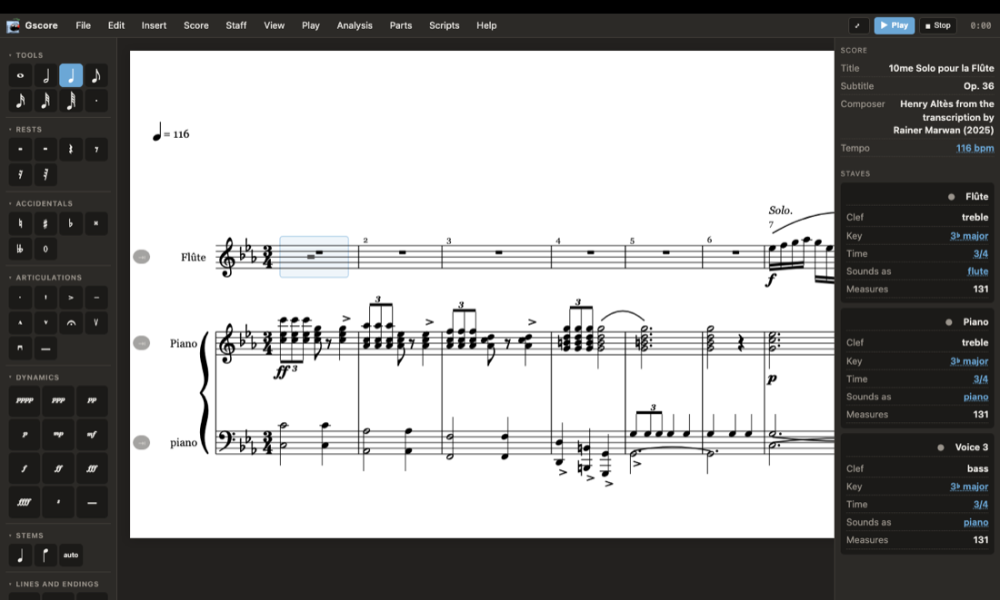
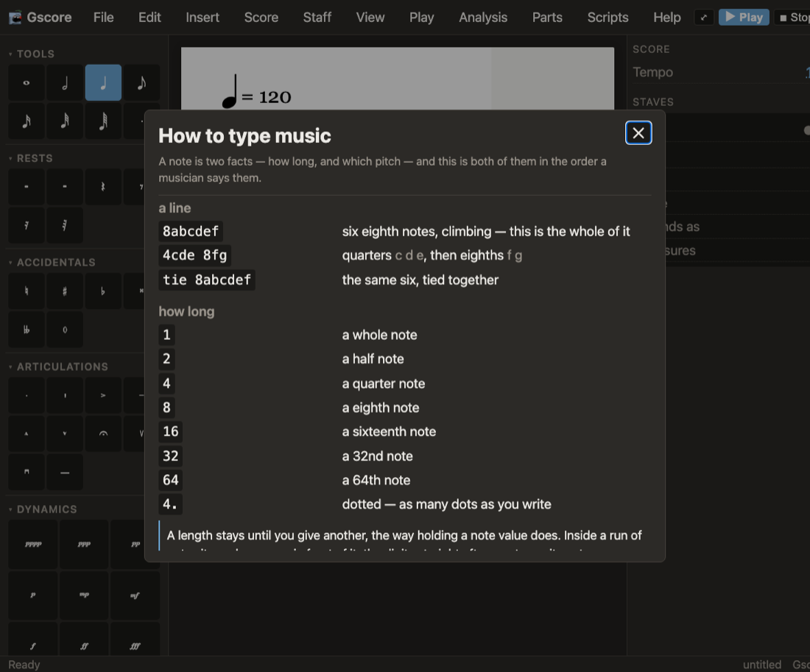
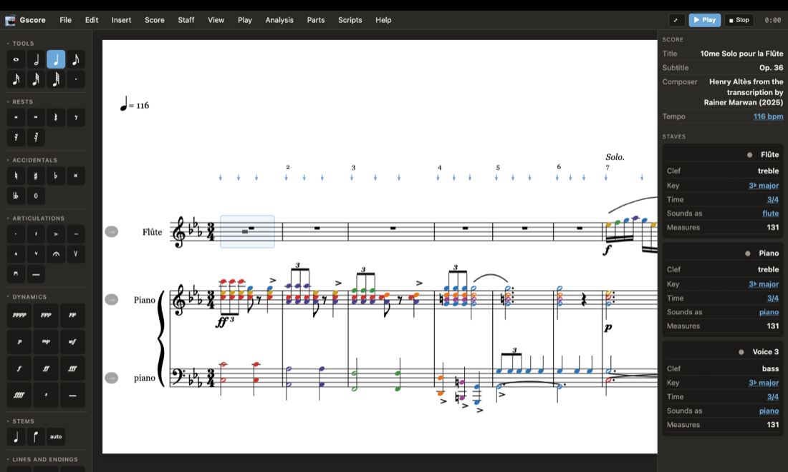

# Quick start

Twenty minutes from never having opened Gscore to a printed part, taken at a walk.

You will write eight bars, hear them played by a real flute, colour the notes
so a beginner can read them, and print the lot. Nothing here needs you to know
what a *mordent* is — and where a word like that turns up, it is in the
[index of musical terms](glossary.md) at the back.

<p class="tip"><b>No installation?</b> There is a copy of the whole program
running in your browser at <a href="../app/">the editor</a>. It is the same
program — not a demo, not a cut-down version — and everything below works in
it. Only the bits that touch your disk behave differently, and those are
pointed out as we come to them.</p>

## 1. Open it and look around

<figure class="shot">

<figcaption><b>The whole window.</b> Toolbox on the left, music in the middle,
inspector on the right — and the music runs off to the right in one unbroken
strip rather than breaking into pages.</figcaption>
</figure>

Three panels, and that is the whole window.

- On the **left**, the toolbox: the note you are about to write, and a zoom
  slider.
- In the **middle**, the music.
- On the **right**, the inspector: what this score is, which staves it has,
  and — if you are writing for flute — the fingering for the note you are on.

Across the top is the menu bar and a play button with a clock beside it.

A new score opens as one empty staff in 4/4. It opens as a **continuous
strip** rather than as pages: one unbroken line of music that runs off to the
right. That is deliberate, and it is the oldest idea in this program — it was
built that way in 2001 because when you are *writing* music, page breaks are
somebody else's problem. When you want to see pages, <span class="menu-path">View →
Paginated</span> gives you pages.

## 2. Write eight bars, four different ways

Here is the thing to understand before anything else: there is no single
"right" way to get notes in. Gscore gives you four, they all write the same
music, and you will end up using all four for different jobs.

### The way everybody tries first: the mouse

Press <kbd>i</kbd>. The pointer is now a pen — click on the staff and a note
appears where you clicked.

Press <kbd>i</kbd> again and the pointer goes back to being a pointer, which
is what you want when you are *editing* rather than writing. (Holding
<kbd>Shift</kbd> flips it either way, so you rarely have to think about it.)

### The way you will actually use: the keyboard

Put the pen away. Now:

<ol class="steps">
<li><b>Choose a length.</b> The number keys are note values, as close to
  obvious as they get: <kbd>1</kbd> whole, <kbd>2</kbd> half, <kbd>4</kbd>
  quarter, <kbd>8</kbd> eighth, <kbd>9</kbd> sixteenth. <kbd>3</kbd> and
  <kbd>5</kbd> are the dotted half and dotted quarter, because those two come
  up often enough to deserve a key of their own.</li>
<li><b>Choose a pitch.</b> <kbd>↑</kbd> and <kbd>↓</kbd> move a step at a
  time; add <kbd>Shift</kbd> for an octave. The toolbox on the left shows
  what you are about to write, so you are never guessing.</li>
<li><b>Write it.</b> <kbd>Space</kbd>. The note goes in and the cursor moves
  on.</li>
<li><b>A rest instead?</b> <kbd>Enter</kbd> writes one of the same length.</li>
<li><b>A chord?</b> Write the bottom note, then <kbd>Ctrl</kbd>+<kbd>Space</kbd>
  (<kbd>⌘</kbd>+<kbd>Space</kbd> on a Mac) adds another notehead to the note
  you just wrote, as many times as you like.</li>
</ol>

Filled a bar? Gscore starts the next one by itself. You do not have to press
anything to make a barline, and if you write a note too long for the room
left, it moves what will not fit into the next bar and keeps the arithmetic
right. <kbd>Tab</kbd> ends a bar early, for the times you meant it.

### The fast way: type it

<figure class="shot">

<figcaption><b>Help → How to type music.</b> The whole syntax, and it is
generated from the parser itself — a length added to the program turns up
here without anybody remembering to write it down.</figcaption>
</figure>

Press <kbd>Ctrl</kbd>+<kbd>K</kbd> (<kbd>⌘</kbd>+<kbd>K</kbd>). A bar opens at
the bottom. Type this into it and press Enter:

```
8abcdef
```

Six eighth notes, climbing. That is the entire syntax of that line — a length,
then the notes. Try a few more:

```
4cde 8fg        quarters c d e, then eighths f g
tie 8abcdef     the same six, tied together
4[ceg]          a C major chord, a quarter long
8c r c r        notes and rests alternating
```

The length sticks until you give another one, exactly the way holding a note
value does. A whole line is read before a single note is written, so a typo
writes *nothing* and tells you what was wrong with your line still sitting in
the box — and everything one line writes comes back with one press of undo.

<span class="menu-path">Help → How to type music</span> is the full syntax, and
it is generated from the parser itself, so it cannot drift out of date.

<p class="tip"><b>Why bother?</b> Because <code>8abcdefgabcdefg</code> is two
seconds of typing and about fifteen seconds of clicking. For scales, drills,
exercises and anything where you already know what the notes are, typing wins
and it is not close.</p>

### The way nobody else offers: write a program

<span class="menu-path">Insert → Script console…</span> gives you a handful of
verbs and the whole of JavaScript:

```js
// A twelve-tone row, then the same row backwards.
const row = ["c4","c#4","e4","f4","g4","g#4","b4","a4","d5","d#5","f#5","a#5"];
for (const p of row) note(p, 8);
bar();
for (const p of [...row].reverse()) note(p, 8);
```

Press Run. Twenty-four notes appear, and **one** press of undo takes all of
them away again.

This is for music that comes out of a process rather than out of your fingers
— a tone row, an isorhythm, a canon at the fifth, forty transposed exercises.
Most notation programs make you install a plug-in and learn its dialect.
Here the language is JavaScript, which you either know or can look up, and
there is a budget on it so a runaway loop stops and says so instead of hanging
the program.

<p class="warn"><b>Nothing in a file ever runs by itself.</b> A score can
carry its scripts, and opening it <i>shows</i> them — unrun. A document that
executes code when you open it is a document that can attack whoever opens it,
which is the mistake Word spent a decade undoing. Gscore does not repeat
it.</p>

## 3. Hear it

<kbd>Shift</kbd>+<kbd>Space</kbd> plays, pauses, and carries on from where it
paused. <kbd>Esc</kbd> stops.

The desktop builds carry a General MIDI soundfont, so the first time you press
play you get recorded instruments and nothing to download. If a staff has no
instrument set, it sounds like a piano, which is what a keyboard with nothing
said about it should sound like.

Want to practise against it? <span class="menu-path">Play → Metronome click</span>
puts a click on every beat, at whatever speed the score is marked — and it
counts the beat the way a musician does, so 6/8 clicks twice in a bar rather
than six times.

## 4. Make it readable for a beginner

This is the bit worth showing somebody who teaches.

<figure class="shot">

<figcaption><b>What this chapter is building towards.</b> Every notehead
coloured by which note it is, and a blue arrow over every beat. Both print,
and both are saved with the score.</figcaption>
</figure>

<span class="menu-path">View → Note colours…</span>, tick **Colour the
noteheads**, and every C in the score goes red, every D orange, and so on up
the spectrum to a violet B. It is the same order as coloured bells and
keyboard stickers, so the page agrees with the instrument in front of the
student.

Three things make it more than a gimmick:

- **C sharp is a C.** It sits on the C line, it is called C, so it takes C's
  colour. The colour teaches the *name*, which is the thing being learnt.
- **Every octave is the same colour.** All the way up the piano.
- **It prints.** The colours go to the PDF and to the printer, not just the
  screen — so the student can take the part away and the colours come with it.

The colours are kept twice over. Pick your own in that dialog and they become
your default, so *every* score you open afterwards is coloured that way, on
screen and on paper, until you turn it off — and they are written into the
score when you save it, so a part sent to a pupil arrives in the colours you
chose rather than in whatever theirs happen to be.

Its neighbour <span class="menu-path">View → Metronome marking</span> draws a
small arrow over every beat. Not the usual "♩ = 120" at the top of the page —
that is <span class="menu-path">View → Tempo marking</span> — but an arrow
over each beat *where it actually falls*, which is what somebody counting a
tied entry or a bar of 7/8 is trying to see.

## 5. Get it out

<span class="menu-path">File → Export</span>, and take your pick:

| Want | Use |
|---|---|
| Something to print or email | PDF (<kbd>Shift</kbd>+<kbd>P</kbd>) |
| Something for another notation program | MusicXML |
| Something for a typesetter | LilyPond |
| Something for a DAW | MIDI |
| Something for a web page | Web page (<kbd>Shift</kbd>+<kbd>H</kbd>) |
| A recording | Audio — played through the soundfont, written as FLAC |

That "Web page" line is worth a second look. It hands you one `.html` file
with the music, the font and a working play button inside it. Put it on any
file host — no server, no plug-in, no account — and it plays. That is covered
in [putting Gscore in a page](embedding.md).

<p class="note"><b>In the browser version</b> the export buttons hand you a
download instead of writing to a folder, and there is no recent-files list,
because there is no "this machine" to have one on.</p>

## Where next

<div class="next-chapter">

<p><span class="where">Next chapter</span>
<a href="tour.html"><b>A tour of the editor</b></a> — every window Gscore can
open, what it is for, and the two or three in each menu that are worth
knowing about.</p>
</div>

- [Things only Gscore does](only-gscore.md) — if you want the short version of
  why this program exists.
- [The user manual](manual.md) — everything, in order, for when you need the
  detail.
- [Index of musical terms](glossary.md) — every term used in this
  documentation, explained.
