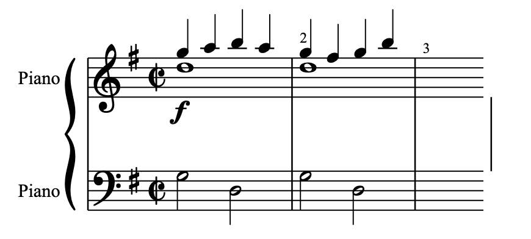
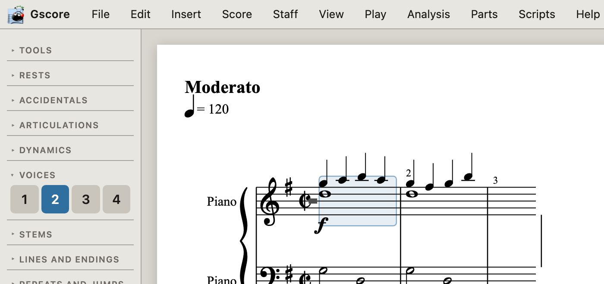
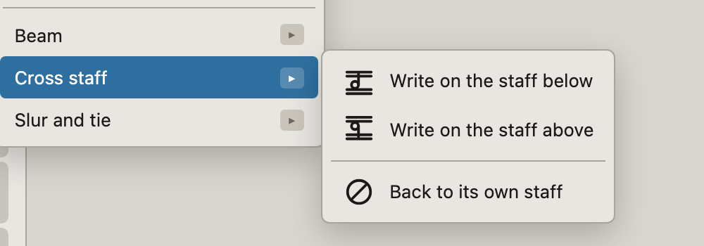

# Two voices on one staff

Where a held note and a moving line share a staff — a piano right hand, an
organ manual, two flutes on one line — they are two **voices**. Gscore writes
them, engraves them, plays them, saves them and hands them to other programs.

<figure class="shot">

<figcaption><b>Two voices, one staff.</b> The upper voice takes its stems up
and the lower takes them down, whichever happens to be the higher note. That
is what tells a reader which line is which, and it is the whole reason two
voices can share a staff at all.</figcaption>
</figure>

A voice is not a chord. A chord is several notes sounding **together, for the
same length**; if the two lines have different rhythms — one holding while
the other moves — no chord can say it, and you need a second voice.

## Writing one

Pick the line, then write. There is no way round picking it first: both lines
are in the same bar at the same moment, so a click on the staff cannot say
which of them it means. Every notation program asks the same question for the
same reason.

<figure class="shot">

<figcaption><b>The <span class="menu-path">Voices</span> section of the
toolbox</b>, with voice 2 held. <kbd>Alt</kbd>+<kbd>1</kbd> to
<kbd>Alt</kbd>+<kbd>4</kbd> do the same from the keyboard.</figcaption>
</figure>

1. Write the upper line as you always would.
2. Click **2** in the toolbox's **Voices** section, or press
   <kbd>Alt</kbd>+<kbd>2</kbd>. The button lights, and the status line says
   which line you are on.
3. Put the cursor where the second line starts and write it.

The second voice is made the moment you write the first note into it — there
is no step for creating one. Delete its last note and it goes away again,
leaving an ordinary one-voice bar rather than an empty line nobody can see.

<p class="tip"><b>The pen follows the music.</b> Clicking a note already
written moves the pen to <em>that</em> note's voice, because that is the only
thing the click could mean. So you rarely have to think about which line is
held: click where you are working and carry on.</p>

Everything else behaves as it always did, on whichever line you are on:
writing, deleting, dotting, lengthening, articulations, slurs, copy and
paste. A selection reaches one line at a time, which is what a slur over the
upper voice means.

<p class="tip"><b>A dynamic is the staff's, not the line's.</b> An <b>f</b>
written on one note is heard by every voice of that staff from there on, and
printed once — which is how it is printed in every edition. You do not write
it twice. A note already sounding when the mark arrives keeps the volume it
began at, the way a player holding a key does.</p>

### Or write it as ABC

ABC has had a word for this since long before gscore did: `&` means what
follows sounds *over* the bar just written, rather than after it.

```abc
X:1
T:Moderato
M:C|
L:1/8
K:G
%%score {RH | LH}
V:RH clef=treble name="Piano"
V:LH clef=bass name="Piano"
[V:RH] !f!g2 a2 b2 a2 & d8 | g2 ^f2 g2 b2 & d8 |
[V:LH] G,4 D,4 | G,4 D,4 |
```

Read the right hand's first bar as: four quarter notes `g a b a`, then `&`,
then the whole note `d` held under all four. Both sides of the `&` must add
up to the same bar — that is the one rule, and a mismatch is what makes a bar
come out overfull. Open it with <span class="menu-path">File → Open
score…</span>, and go on editing it in the usual way.

<p class="warn"><b>Not in the typing bar.</b> A line beginning <code>abc</code>
in the typing bar (<kbd>Ctrl</kbd>/<kbd>⌘</kbd>+<kbd>K</kbd>) goes to the same
reader, but a typed fragment is <em>flattened</em> so that its notes fill the
score's own bars — and a flat stream has nowhere to put a second voice. The
<code>&amp;</code> and everything after it is dropped. Pick the voice and type
the line instead.</p>

## What carries it

A second voice is only worth writing if it survives the journey. It does:

| | |
|---|---|
| Drawn with the stems opposed | yes |
| Played, both lines sounding | yes |
| Saved as `.gscore` and opened again, still editable | yes |
| Printed, exported to PDF | yes |
| Read from ABC, MusicXML, MuseScore, Guitar Pro | yes |
| Written to ABC (`&`), MusicXML (`<backup>`), LilyPond, GUIDO | yes |

<p class="tip"><b>MusicXML used to lose it.</b> Every other format wrote the
second voice back out; MusicXML wrote the first voice and stopped, with no
<code>&lt;backup&gt;</code> and no warning, so a piano part's held notes
vanished on the way to another program. It now writes a
<code>&lt;voice&gt;</code> on every note and a <code>&lt;backup&gt;</code>
between the lines, which is how the format says two lines share a
staff.</p>

## Two things to try instead

Before reaching for a second voice, check whether one of these says what you
mean.

### A chord with the stems forced

Where the two lines move **in the same rhythm**, they are not two voices —
they are chords, and should be written as chords. If you want the stem to go
a particular way regardless, <span class="menu-path">Edit → Stem → Up</span>
or **Down** (<kbd>U</kbd> and <kbd>D</kbd>) settles it.

### Cross-staff, for a hand reaching over

<figure class="shot">

<figcaption><span class="menu-path">Edit → Cross staff → Write on the staff
above</span>. The note keeps its pitch, its bar, its voice and its sound —
only where it is <em>drawn</em> moves, and a beam will cross between the
staves.</figcaption>
</figure>

This is the answer when the figure really belongs to one hand's rhythm and
simply runs past what that hand can reach. It is not a substitute for a
second voice: the note still takes its time out of the bar it came from, so
it only helps where the other staff is free at that moment.

## For scripts and the API

A voice is one more number on a position, and it defaults to the first line,
so everything written before voices could be reached goes on meaning what it
meant.

- The routes that write take `&voice=N`, counted from zero:
  `/api/insert`, `/api/delete`, `/api/paste`, `/api/dot`, `/api/abc`,
  `/api/tab`, `/api/fretchord`.
- The selection grammar writes the index as `voice/index` where the music is
  not on the first line: `sel=0:3:1/2` is the third element of the second
  voice of bar 3. A bare `0:3:2` is the first voice, as before.
- `/api/layout` gives every drawn element a `voice`, and its `index` is its
  place **within that voice** — which is the only index an edit can be
  addressed by.

Four lines to a staff, which is what MusicXML's writers settled on and more
than anybody reads off one staff at a stand.

---

*See also: [the manual](manual.md) on how a score is put together, and the
[index of musical terms](glossary.md) for anything unfamiliar.*
